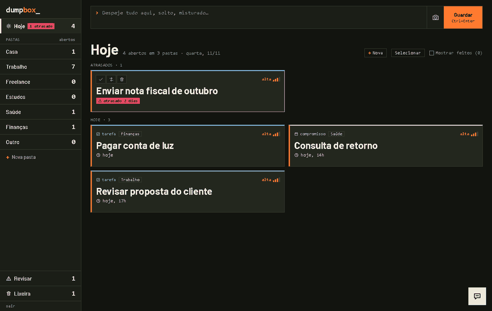
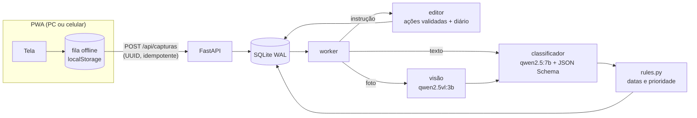
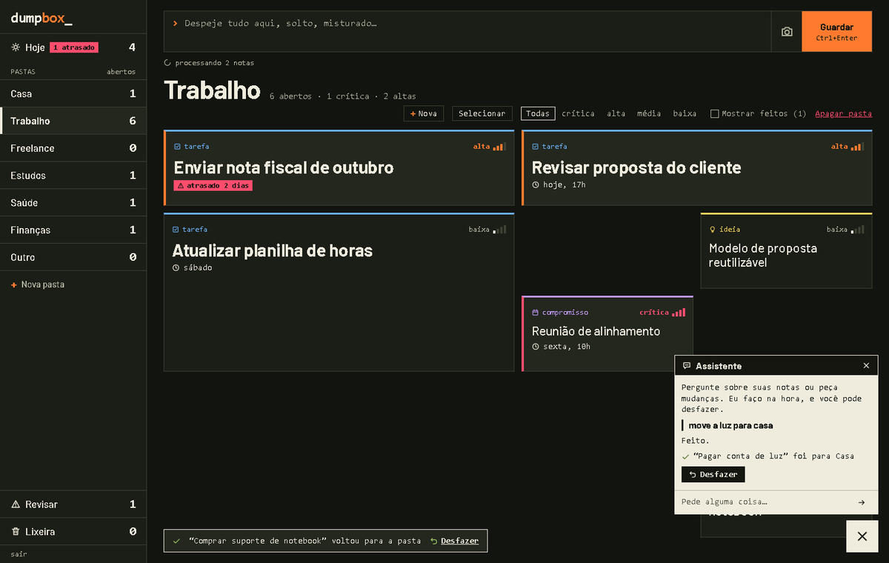
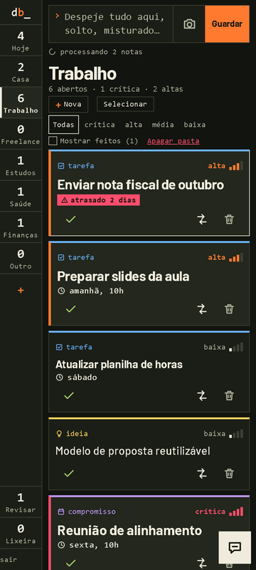

# dumpbox

Despeje texto solto (ou o print de uma lista), a IA cataloga. Notas viram itens com tipo, pasta, prazo e criticidade. Roda 100% local (Ollama no PC), sem nuvem.



> Status: classificador com avaliação (150 casos), **API + PWA com login**, editor inteligente, pastas com grade livre e **foto de lista virando itens** prontos. Próximos: app no celular sem depender do PC (modo demo clicável), bot de lembretes no Telegram. Dados das imagens: sintéticos.

**Destaques técnicos**
- **LLM local com saída validada:** JSON Schema gerado do Pydantic a cada chamada (enum com as pastas que existem agora), retry e nota que nunca se perde.
- **A IA não calcula datas:** o modelo copia o trecho ("sexta 14h") e um parser determinístico em pt-BR resolve; prazo 99% no benchmark.
- **Ações da IA reversíveis:** conjunto fechado, validadas no servidor, item precisa ser citado, tudo num diário com Desfazer; texto de nota tratado como não confiável (prompt injection).
- **Visão:** print de checklist → `qwen2.5vl:3b` lê linhas e marcas → o que já existe é fechado, o resto vira item. Avaliado em checklists gerados por script.
- **Avaliação reproduzível:** harness de texto e de visão com dataset público sintético; decisões de prompt medidas (tabelas abaixo).
- **Exe para PC sem nada instalado:** baixa Ollama portátil e o modelo certo pela RAM; CI gera o exe em tags.

## Como funciona



| Hoje e pastas | Assistente com Desfazer | Celular |
|---|---|---|
|  |  |  |

- **Tudo roda no seu PC** (Ollama + FastAPI + SQLite). O celular só abre a PWA, com login próprio.
- **Offline-first no navegador:** notas ficam numa fila local com UUID e são enviadas quando o servidor volta (idempotente).
- **Nunca perde nota:** se a IA falha, a captura fica em "Revisar" com o texto original.
- **A IA não calcula datas.** O modelo copia o trecho (`prazo_texto`); um parser determinístico em pt-BR resolve a data e a prioridade.
- Saída do modelo forçada por JSON Schema (gerado do Pydantic, com o enum das pastas que existem no momento).

### A caixa de notas é um editor, não só um separador
- Linhas comuns viram itens novos; linhas que são instrução ("mover X para estudos", "excluir os duplicados") **são executadas** sobre os itens existentes.
- Pedidos em massa ("separar melhor tudo que está em trabalho") fazem a IA revisar a pasta de cada item daquele escopo.
- **Aprende com você:** cada item que muda de pasta (arraste, menu, instrução) vira exemplo no prompt das próximas notas.
- Colagem do WhatsApp: o cabeçalho `[hora, data] Nome:` sai do texto e "amanhã"/"sex" contam a partir da data da mensagem.
- Tudo o que a IA muda vai para um diário e tem **Desfazer**; "excluir" manda para a Lixeira.

### A tela
- **Pastas** na lateral (no celular, um trilho): crie e apague as suas; a IA passa a usar a pasta nova na hora. Mais **Hoje** (atrasados e prazos do dia de todas as pastas), **Revisar** e **Lixeira** (Restaurar / Apagar de vez com confirmação).
- **Grade livre** dentro da pasta: solte o card em qualquer célula e aumente pelo canto, com prévia do tamanho; nada se sobrepõe.
- **Criticidade** em 4 níveis (crítica, alta, média, baixa) e filtro por nível. A regra sugere pelo prazo; o que você marca à mão não é recalculado.
- **Seleção múltipla:** clique, Ctrl+clique, Shift+clique, laço arrastando no vazio, Ctrl+A; ações em lote com um Desfazer. No celular, botão "Selecionar".
- **Foto ou print de lista** (botão de câmera ou Ctrl+V): fica anexada como miniatura para você escrever instruções; linhas marcadas fecham itens que já existem, o resto vira item.
- **+ Nova** cria tarefa à mão, sem IA. **Janela flutuante da IA** para perguntar e pedir mudanças (aplica na hora, com Desfazer; nunca apaga de vez).

Os mockups que guiaram a tela estão em [`docs/mockups/`](docs/mockups/) (a escolhida foi a B2).

## Usar (Windows, sem instalar nada)

1. Baixe o `dumpbox.exe` em [Releases](../../releases) e dê duplo clique (a primeira release sai na versão 1.0; até lá, use a instalação para desenvolvedores abaixo).
2. Se o Windows mostrar "O Windows protegeu seu PC" (o exe não é assinado): **Mais informações → Executar assim mesmo**.
3. O navegador abre sozinho. Crie uma senha e pronto.
4. Na **primeira vez** o app baixa o motor de IA (Ollama) e o modelo, com barra de progresso na tela. Precisa de ~10 GB livres e internet. Enquanto isso você já pode guardar notas; elas são classificadas quando a IA ficar pronta.

- **Modelo escolhido pela RAM:** 16 GB ou mais usa `qwen2.5:7b`; menos que isso usa `qwen2.5:1.5b` (mais leve, bem menos preciso; veja o benchmark).
- **Dados:** `%LOCALAPPDATA%\dumpbox` (banco, senha e modelos). Para desinstalar, apague essa pasta e o exe.
- Mantenha a janela do dumpbox aberta enquanto usa; fechar encerra o app.
- Tudo roda local: nenhuma nota sai do seu PC.

## Instalação para desenvolvedores (qualquer SO)

```bash
pip install -r requirements.txt
ollama pull qwen2.5:7b                      # PC fraco: qwen2.5:1.5b (menos preciso, ver benchmark)
python run.py          # sobe o servidor, abre o navegador e prepara Ollama + modelo sozinho
# ou, com Ollama já instalado: python -m uvicorn dumpbox.api:app --app-dir backend
.\build.ps1            # gera dist\dumpbox.exe (Windows)
```

No Windows, `iniciar.ps1` sobe o Ollama e o servidor juntos (ajuste `OLLAMA_EXE`/`OLLAMA_MODELS` se não for o caminho padrão).

### Acessar de outro aparelho (opcional)
O projeto não depende de nenhum serviço de rede. Escolha o que preferir:
- **Mesma rede Wi-Fi:** `--host 0.0.0.0` e abra `http://<ip-do-pc>:8000` (HTTP, só em rede confiável).
- **Fora de casa:** VPN privada como [Tailscale](https://tailscale.com) (`tailscale serve --bg 8000` dá HTTPS) ou um túnel como Cloudflare Tunnel. Com HTTPS, defina `DUMPBOX_COOKIE_SECURE=1`.
- Nunca exponha a porta direto na internet (port-forward): o login é de usuário único e simples.

## Testes

```bash
python tests/test_rules.py                 # regras de data e prioridade
python tests/test_api.py                   # API, editor, pastas, lixeira (Ollama trocado por um falso)
pip install playwright && python tests/ui_browser.py   # tela real no Chrome, PC e celular (banco temporário)
```

## Avaliação

```bash
ollama pull qwen2.5:7b
python eval/run_eval.py qwen2.5:7b            # dataset sintético público
python eval/run_eval.py qwen2.5:7b data/private/casos.jsonl   # suas notas reais (não vai pro git)
```

Métricas: JSON válido, acerto do nº de itens (split), tipo, contexto, prazo, latência p50.

### Resultados (texto)

| modelo | json válido | split | tipo | contexto | prazo | p50 |
|---|---|---|---|---|---|---|
| qwen2.5:1.5b, prompt v1 | 100% | 93% | 73% | 29% | 80%* | 2,7 s |
| qwen2.5:1.5b, prompt v2 | 100% | 93% | 53% | 73% | 87% | 2,4 s |
| qwen2.5:7b, prompt v2 | 100% | 98% | 96% | 89% | 98% | 3,2 s |
| qwen2.5:7b, prompt v2 atual (46 casos) | 100% | 98% | 96% | 87% | 98% | 3,2 s |
| **qwen2.5:7b, v2 + regras de prazo (150 casos)** | 100% | 99% | 97% | 91% | 99% | 3,2 s |

Casos sintéticos (46 até a v2; 150 desde as regras de prazo, com 3 datas-base, notas com data que não é prazo e listas de 2-3 itens), CPU (sem GPU), p50 por nota. Regras de prazo: item único cujo trecho não vira data é lido da nota inteira (o modelo corta "dia 4" em "4"), e `nota` nunca tem prazo. *v1 medido antes de corrigir o parser de datas. Prompt v2 = definições fechadas + 3 exemplos fixos; "atual" = v2 com estudos ampliado (faculdade, AVA, artigo, TCC), um caso de diferença em contexto. Na prática o contexto melhora com os exemplos aprendidos do usuário, que o benchmark não usa.

### Foto de lista (visão)

`qwen2.5vl:3b` transcreve e marca o que está feito; o classificador de texto cataloga. 24 checklists sintéticos (`python eval/gera_imagens.py`, depois `python eval/run_eval_visao.py`):

| modelo | itens achados | inventados | marcado certo | caixa ✓ | caixa X | riscado | p50 |
|---|---|---|---|---|---|---|---|
| qwen2.5vl:3b | 100% | 1 | 89% | 100% | 92% | 76% | 9,6 s |

Com JSON Schema o 3B devolvia lista vazia; o protocolo é texto (`item => marcada/vazia`). Texto riscado é o ponto fraco. Se o modelo marcar a lista inteira, nada é fechado sozinho.

## Estrutura

```
backend/dumpbox/   api.py (FastAPI), db.py (SQLite, pastas, lixeira), classifier.py (Ollama), editor.py (instruções),
                   chat.py (ações + diário/Desfazer), rules.py (datas/prioridade), schema.py (contrato), ollama_mgr.py
web/               PWA: index.html, app.js, sw.js, fonts/ (Barlow, OFL)
tests/             test_rules.py, test_api.py, ui_browser.py
eval/              harness de avaliação (texto e visão) e gerador de checklists sintéticos
data/public/       casos sintéticos e imagens de checklist geradas
data/private/      notas reais (gitignored)
docs/              arquitetura, decisões e mockups
```

## Documentação

- [`docs/uso.md`](docs/uso.md): guia de uso da tela (anotar, instruções, pastas, seleção, IA, celular)
- [`docs/api.md`](docs/api.md): referência da API HTTP
- [`docs/desenvolvimento.md`](docs/desenvolvimento.md): rodar, variáveis de ambiente, testes, eval, backup, release
- [`docs/arquitetura.md`](docs/arquitetura.md): decisões atuais (PWA, exe, editor, tela, IA), modelo de dados, fases
- [`docs/planejamento.md`](docs/planejamento.md): ideia, decisões, revisão crítica
- [`docs/visao-imagem.md`](docs/visao-imagem.md): entrada por imagem (checklist)
- [`docs/ambiente.md`](docs/ambiente.md): o que já está baixado e o que falta instalar

## Privacidade

Repo público: nenhuma nota real. `data/private/`, `.env` e modelos `.gguf` ficam no `.gitignore`; testes e mockups usam dados inventados. Pesos dos modelos têm licença própria (ex.: Qwen2.5-1.5B é Apache 2.0; Qwen2.5-VL-3B usa a Qwen Research License); não são redistribuídos aqui. A fonte Barlow vai junto em `web/fonts/` sob a SIL Open Font License.

## Licença

[MIT](LICENSE).
